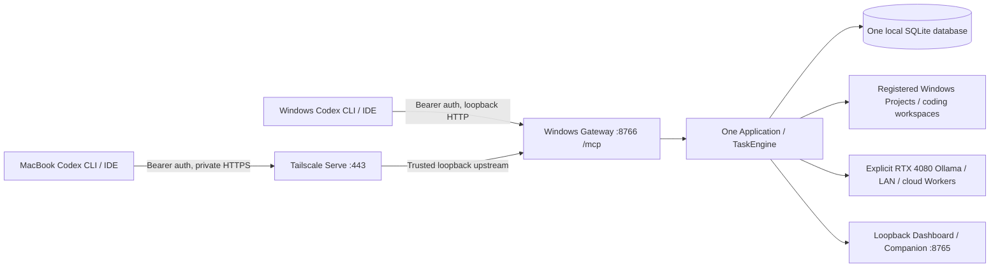

# Persistent authenticated MCP Gateway

One Windows host runs one persistent AgentForge Application, TaskEngine and local
SQLite database. Windows Codex and MacBook Codex are independent Directors that
connect to that service. Opening/closing a Codex session does not start/stop an
executor or terminate its Tasks. Standalone stdio remains available as an exclusive
alternative. Never configure stdio against the Gateway's database.



This is application authorization for trusted Directors with separate identities,
not an OS sandbox for hostile tenants. Protect the Windows account, installation,
private state, Git metadata and validators. Workers never choose another Worker.
The [transport decision](gateway-design.md) records verified SDK/client behavior.

## Install on Windows

Use ordinary local fixed NTFS for database/state and supported repositories; do
not put SQLite on SMB, OneDrive, a shared drive or an unsupported filesystem.
Install Python 3.12+ and Git for Windows as described in
[native Windows setup](native-windows-smoke.md). From a reviewed checkout, build
`python -m build`; copy the wheel to the Windows host. PowerShell commands below
use example absolute paths. No command provisions a paid Provider or performs a
real inference probe.

```powershell
py -3.12 -m venv C:\AgentForge\venv
$afPython = 'C:\AgentForge\venv\Scripts\python.exe'
& $afPython -m pip install C:\Downloads\agentforge-0.1.0-py3-none-any.whl
New-Item -ItemType Directory -Force C:\AgentForgeState
$afAccount = [Security.Principal.WindowsIdentity]::GetCurrent().Name
icacls C:\AgentForgeState /inheritance:r /grant:r "${afAccount}:(OI)(CI)F"
& $afPython -m agentforge db upgrade --database-url 'sqlite:///C:/AgentForgeState/gateway.db'
```

Existing installations must stop executors and back up the database/workspaces
before upgrading to `0002_gateway_client`. It adds a nullable submitting-client
identity without changing old Tasks. Existing operator/stdio history has no client
owner and requires an explicit shared-history grant for HTTP access. Never infer
an owner from Task text. Migrations are explicit and never run on connection.

Create `C:\AgentForgeState\workers.toml`, using the actual installed Ollama model
ID (the example is a placeholder, not an availability promise):

```toml
[[workers]]
id = "local-4080"
provider = "ollama"
model = "<installed-tool-capable-model-id>"
endpoint = "http://127.0.0.1:11434"
supports_tools = true
supports_streaming = true
deployment_label = "Windows RTX 4080"
```

Add LAN/cloud connections through [Provider configuration](providers.md). Keep API
keys in the Gateway account's secret environment; never send those keys to Codex
clients. Every Project-to-Worker grant below explicitly permits that destination
to receive the Project's Task context and tool results. Adding a cloud Worker to
configuration alone grants no HTTP client access. No probing, fallback, paid use
or source export happens automatically.

Register an operator-authorized Windows checkout, optionally refresh its Index:

```powershell
& $afPython -m agentforge worker config-check --workers C:\AgentForgeState\workers.toml
& $afPython -m agentforge project add C:\Projects\FieldForge --name FieldForge --database-url 'sqlite:///C:/AgentForgeState/gateway.db'
# Retain the returned project_id. Indexing is optional for document analysis.
& $afPython -m agentforge project index '<project-uuid>' --database-url 'sqlite:///C:/AgentForgeState/gateway.db'
```

Stop the executor for administrative writes (registration/indexing/migrations).
The remote MCP surface cannot register roots, edit policy, install Providers,
execute arbitrary shell commands or change configuration.

## Provision separate client credentials and grants

Run on Windows, under the protected state account:

```powershell
& $afPython -m agentforge gateway client-add --auth C:\AgentForgeState\clients.json --client-id windows-codex --token-file C:\AgentForgeState\windows.token
& $afPython -m agentforge gateway client-add --auth C:\AgentForgeState\clients.json --client-id macbook-codex --token-file C:\AgentForgeState\macbook.token
```

Each command generates a 384-bit random bearer credential in a new private output
file. It prints identity/operation only and refuses repository destinations or
existing token files. `clients.json` holds SHA-256 hashes and authorization policy;
it never holds bearer values. New identities have **no tool, Project, Agent or
Worker grants**. Do not reuse client IDs for different people/devices: durable
Task ownership follows the stable ID through rotation.

Edit each existing client entry in the private JSON, retaining its generated
`client_id`, `token_sha256`, `enabled` and `expires_at`. For read-only analysis
and explicit lifecycle control, set these fields (replace the UUID):

```json
{
  "tools": [
    "agentforge_status", "describe_capabilities", "list_projects", "list_workers",
    "list_agents", "delegate_task", "get_task", "watch_task", "cancel_task",
    "delegate_council", "get_council", "cancel_council"
  ],
  "projects": [{"project_id": "<project-uuid>", "workers": ["local-4080"]}],
  "agents": ["general_agent", "repo_explorer"],
  "read_shared": false,
  "cancel_shared": false,
  "coding_submit": false
}
```

This is a field example, not a replacement for the whole file. The file's top
level is `{"clients": [<full client entries>]}`. `expires_at` is an optional Unix
UTC timestamp. `tools` is an exact allowlist; there are no wildcard grants.
Discovery filters before pagination. Task access requires the Project, Agent,
Worker and tool grant, plus ownership. Council access checks every participant
before revealing answers or cancelling any participant.

To let both Directors inspect each other's authorized Tasks/Councils, explicitly
set `read_shared: true` on each intended reader. Shared cancellation additionally
requires `cancel_shared: true` and the cancellation tool. Shared grants also cover
matching pre-Gateway operator/stdio history. Cancellation does not follow from
read access. `agentforge_status` returns the authenticated client ID and scoped
counts, not other clients' private activity.

Coding requires an explicit trusted `--coding` file, an authorized coding Agent,
`delegate_task` and `coding_submit: true`. Inspection/diffs require their respective
`get_coding_workspace`/`get_coding_diff` grants; cleanup requires
`cleanup_coding_workspace`, ownership or shared cancellation, and the existing
workspace identity/terminal-state checks. Ordinary Task snapshots redact coding
captures unless workspace inspection is granted. Keep coding opt-in, with explicit
Director approvals; existing [coding trust boundaries](coding.md) still apply.

Write policy updates through a same-directory temporary file and atomic replace;
serialize operator edits and credential commands. On Windows NTFS, use
`[IO.File]::Replace($temporary, $authPath, $null)` after saving valid UTF-8 JSON.
Protect temporary files with the same directory ACL. Validate before replacement
by running `gateway auth-check --auth <temporary>`, then validate the live file:

```powershell
& $afPython -m agentforge gateway auth-check --auth C:\AgentForgeState\clients.json
```

Malformed/missing policy fails closed; it is never replaced with cached grants.
The file is checked on every HTTP request and operation. Active watches recheck
within one second and before sending each notification. Revocation stops further
access; it does not cancel already committed Tasks. Use explicit cancellation
before revocation if required. Revocation cannot retract data already delivered.

## Start the persistent service

For local-only operation:

```powershell
& $afPython -m agentforge gateway serve --database-url 'sqlite:///C:/AgentForgeState/gateway.db' --workers C:\AgentForgeState\workers.toml --auth C:\AgentForgeState\clients.json --concurrency 2 --companion
```

Keep this operator-owned terminal open. Closing Codex leaves it running. The
Gateway alone starts recovery/execution; SDK session lifespans borrow it. Opening
`http://127.0.0.1:8765/companion` on Windows shows shared Tasks, Councils, configured
Workers/models and progress. The same listener contains the Dashboard at `/`.
Do not proxy port 8765 to remote clients. Its trusted operator controls remain
unauthenticated, with their existing Host/CSRF protection. The MCP listener mounts
only `/mcp`, with no Dashboard, static files or operator routes.

## Add private remote HTTPS

The preferred setup uses Tailscale on both devices with narrowly scoped tailnet
access rules, TLS termination on the Windows machine, and independent MCP bearer
authentication. VPN membership alone never authorizes a client.

Enable HTTPS/Serve as required by your tailnet policy. In an administrator terminal
for Tailscale configuration, after inspecting existing `tailscale serve status`:

```powershell
tailscale serve status
tailscale serve --bg --https=443 http://127.0.0.1:8766
tailscale serve status
```

Use **Serve**, without enabling Funnel/public access. Restart the Gateway with
its exact advertised hostname allowed (replace `workstation.example.ts.net`):

```powershell
& $afPython -m agentforge gateway serve --database-url 'sqlite:///C:/AgentForgeState/gateway.db' --workers C:\AgentForgeState\workers.toml --auth C:\AgentForgeState\clients.json --concurrency 2 --companion --trusted-tls-proxy --allowed-host '127.0.0.1:8766' --allowed-host 'localhost:8766' --allowed-host 'workstation.example.ts.net'
```

The reverse proxy must preserve an allowed Host or set it to the allowed upstream
authority; preserve Authorization, MCP session/protocol headers and SSE responses.
Disable response buffering; allow the 30-second watch window plus overhead.
The Gateway ignores forwarded IP/Host/proto headers and Uvicorn proxy trust is
disabled. It makes no identity decision from proxy headers. TLS termination must
be on this trusted loopback upstream; do not forward plaintext over a LAN hop.
No Origin is allowed by default. Native Codex sends no browser Origin; if another
client requires one, supply an exact trusted `--allowed-origin https://...`.

Alternatively bind an explicit private/tailnet IP with `--tls-cert` and `--tls-key`,
and exact `--allowed-host` authorities. Non-loopback plaintext, unspecified/public
binds and wildcard Host values are refused. Operate certificate renewal and private
key ACLs yourself. Do not disable TLS verification on clients. Keep firewall rules
restricted to the intended private interface/devices.

[Tailscale Serve reference](https://tailscale.com/docs/reference/tailscale-cli/serve)
describes certificate provisioning, persistent `--bg` behavior and removal with
`tailscale serve off`. These network/Windows commands still require device testing.

## Connect Codex on Windows and MacBook

Remove/disable every old AgentForge stdio registration and close its existing
process **before** starting the Gateway. Preserve unrelated Codex settings. For a
registration managed by Issue #49, use the existing reversible installer on Windows:

```powershell
# Load this device's token privately, without placing it in TOML or command argv.
$env:AGENTFORGE_MCP_TOKEN = (Get-Content -Raw C:\AgentForgeState\windows.token).Trim()
& $afPython -m agentforge codex install --url 'http://127.0.0.1:8766/mcp' --bearer-token-env-var AGENTFORGE_MCP_TOKEN --instructions --dry-run
& $afPython -m agentforge codex install --url 'http://127.0.0.1:8766/mcp' --bearer-token-env-var AGENTFORGE_MCP_TOKEN --instructions
codex mcp list
codex
```

This replaces only the managed MCP block, keeps unrelated settings/instructions,
backs up changes and never starts an executor. `codex inspect`, `disable`, `enable`
and `uninstall` retain their existing ownership rules; HTTP enable does not require
`--single-client`. Existing unmanaged conflicting registrations require explicit
operator reconciliation. Do not run stdio and HTTP entries for the same deployment.

Transfer only `macbook.token` to a private MacBook credential file using a separate
authorized secure mechanism. Do not transfer the database, Provider keys or an
AgentForge installation. Keep the Windows provisioning copy private or delete it
after secure delivery. On macOS, with the official Codex CLI already installed:

```sh
chmod 600 "$HOME/.config/agentforge/macbook.token"
export AGENTFORGE_MCP_TOKEN="$(cat "$HOME/.config/agentforge/macbook.token")"
codex mcp add agentforge --url https://workstation.example.ts.net/mcp \
  --bearer-token-env-var AGENTFORGE_MCP_TOKEN
codex mcp list
codex mcp get agentforge
codex
```

The MacBook needs no AgentForge package or executor. `codex mcp remove agentforge`
reverses this official registration. For an existing entry, inspect/back up and
remove that entry before adding its replacement. Use `default_tools_approval_mode
= "writes"` and `disabled_tools = ["cleanup_coding_workspace"]` in that server's
TOML table if not already supplied by your client policy. Preserve other settings.
Existing Issue #49 global delegation guidance remains useful; it grants no server
permissions and does not replace any repository AGENTS.md. See
[Codex integration](codex-integration.md) for policy ownership/backups.

CLI and IDE share configuration, but the token environment must be present in each
process that launches the CLI/IDE; launch the IDE from a prepared environment or
use your organization's secret manager. Shell `export` does not change an already
running GUI's environment. Restart the client after rotation/config changes.
Never put the token in a URL, TOML `http_headers`, Git, a transcript or a screenshot.
The supported [Codex MCP configuration](https://developers.openai.com/codex/mcp/)
and [CLI reference](https://developers.openai.com/codex/cli/reference/) document
Streamable HTTP and `bearer_token_env_var`/`--bearer-token-env-var`.

## End-to-end repository analysis from MacBook

After Windows registers an authorized FieldForge checkout, configures the real
RTX 4080 Ollama Worker, and grants the MacBook client that Project/Worker pair:

1. In MacBook Codex, request: “Use AgentForge to inspect the authorized Windows
   FieldForge checkout. Discover Projects, Agents and Workers, then explicitly
   delegate README/build architecture analysis to `repo_explorer` on `local-4080`.
   Cite inspected files and retain the Task ID. Do not modify files.”
2. Codex discovers the authorized UUID and submits `delegate_task` with that UUID,
   `agent_id=repo_explorer`, `worker_id=local-4080` and the bounded request.
3. Observe `watch_task` or poll `get_task`. Reconnect using the returned Task ID
   after a network interruption. Do not blindly resubmit an ambiguous submission:
   its durable commit may have succeeded. The Windows operator can locate a lost
   ID in Companion. Submission deduplication/idempotency keys are not implemented.
4. Windows Companion shows the same Task and real Worker/model attribution. A
   Windows Codex client can inspect it only with the required shared read grant.
5. MacBook Codex independently verifies the answer against the intended revision
   and its local checkout. It continues Xcode/build/signing/device work locally.

The Gateway cannot see Mac-local paths or uncommitted changes. Native Codex tools
can edit the Mac checkout; Git can transfer committed changes to an independently
authorized Windows checkout. Check branch/commit equality before trusting analysis.
No automatic synchronization, remote arbitrary shell or file bridge is provided.
Mac-local AgentForge/filesystem support remains **Issue #45**.

## Shutdown, restart and optional startup

For a foreground Gateway, press Ctrl+C once and wait for process exit. Shutdown
closes sessions, observers, execution/Provider resources and Companion, then
releases the SQLite ownership lock. Active Tasks become `executor_cancelled`
(unless an earlier explicit cancellation won); queued Tasks remain queued. On a
crash/forced termination, the next exclusive owner marks orphaned running Tasks
`execution_interrupted` and continues queued Tasks. Running work is never replayed.
Workspace recovery retains partial edits for explicit inspection; it does not
create duplicate worktrees or merge changes. Remote inference may continue after
local cancellation or process exit. See [executor ownership](executor-ownership.md).

For optional startup at user logon, stop the foreground Gateway first. Create a
Task Scheduler task under the same authorized account, without elevated runtime
privileges or stored password (interactive logon). Example uses the local mode;
include the exact TLS-proxy/Host arguments above for remote access:

```powershell
$afAction = New-ScheduledTaskAction -Execute $afPython -WorkingDirectory 'C:\AgentForge' -Argument '-m agentforge gateway serve --database-url "sqlite:///C:/AgentForgeState/gateway.db" --workers "C:\AgentForgeState\workers.toml" --auth "C:\AgentForgeState\clients.json" --concurrency 2 --companion'
$afTrigger = New-ScheduledTaskTrigger -AtLogOn -User $afAccount
$afPrincipal = New-ScheduledTaskPrincipal -UserId $afAccount -LogonType Interactive -RunLevel Limited
$afSettings = New-ScheduledTaskSettingsSet -MultipleInstances IgnoreNew -ExecutionTimeLimit ([TimeSpan]::Zero) -StartWhenAvailable -RestartCount 3 -RestartInterval (New-TimeSpan -Minutes 1)
Register-ScheduledTask -TaskName 'AgentForge Gateway' -Action $afAction -Trigger $afTrigger -Principal $afPrincipal -Settings $afSettings
Start-ScheduledTask -TaskName 'AgentForge Gateway'
Get-ScheduledTaskInfo -TaskName 'AgentForge Gateway'
```

Check the account's Provider-secret environment and connection/Companion health
after logon. This mode runs while that user remains logged in; it does not promise
operation through logoff, sleep or power loss. No privileged Windows service is
required. `IgnoreNew` reduces accidental duplicates; the kernel lock still enforces
exclusive ownership. [Scheduler settings reference](https://learn.microsoft.com/en-us/powershell/module/scheduledtasks/new-scheduledtasksettingsset?view=windowsserver2025-ps).

Task Scheduler's Stop is forceful. For maintenance, first let all queued/running
Tasks finish (or explicitly cancel and wait for terminal states), stop the
scheduled task, then upgrade/restart. Stopping during active work uses the crash
recovery semantics above. To remove startup, after stopping the task:
`Unregister-ScheduledTask -TaskName 'AgentForge Gateway' -Confirm:$false`.
Do not delete `.agentforge.lock` sidecars; the OS releases the lock automatically.

## Rotate/revoke and troubleshoot

```powershell
& $afPython -m agentforge gateway client-rotate --auth C:\AgentForgeState\clients.json --client-id macbook-codex --token-file C:\AgentForgeState\macbook-next.token
& $afPython -m agentforge gateway client-revoke --auth C:\AgentForgeState\clients.json --client-id macbook-codex
```

Rotation preserves grants and stable ownership, invalidates the old token, and
requires a fresh MCP initialization with the new credential. Replace the client
secret/environment privately and restart Codex/IDE. Revocation takes effect on the
next request/operation and within one second for an active watch. A later explicit
rotation re-enables the identity; an expired `expires_at` must also be changed
explicitly. There is no HTTP credential-administration API.

| Symptom | Operator check |
| --- | --- |
| Connection refused / TLS failure | Gateway process, exact `/mcp` URL, Tailscale ACL/Serve status, certificate hostname/trust, sleep/network state. Do not disable certificate checks. |
| HTTP 401 | Missing/wrong/expired/revoked token, stale GUI environment, malformed/missing private policy; run `auth-check`. |
| HTTP 403 / 421 | Exact Origin / Host allowlist, preserved proxy Host; forwarded headers grant no exception. |
| `access_denied` tool result | Tool grant, Project/Worker pair, Agent, owner/shared read, separate cancellation/coding grants. Unknown and unauthorized Task/Council IDs have the same denial. |
| Session HTTP 404 | Expired/deleted/restarted session or different credential; initialize afresh and retrieve the existing Task ID. |
| HTTP 413 / 503 or `resource_limit` | Body, connection, session, watch or pending-work capacity; back off. Do not resubmit possibly committed delegation blindly. |
| Startup unavailable / competing executor | Current schema, supported local NTFS/Linux storage and ACLs, one owner; inspect old stdio/web/scheduled processes before restarting. |
| Model/Worker failure | Explicit Worker configuration, required environment, actual model/tool support; no automatic fallback. |

Default bounds: 64 sessions, 300 seconds idle with no HTTP request/GET stream,
128 connections, 256 pending/running Tasks, 256 KiB bodies, 5 seconds body reading,
60 seconds per HTTP stream, and 30 seconds per watch. At most four progress watches
per client and 32 total; notifications have a two-second delivery deadline.
Session/pending limits are configurable within server bounds. SDK expiry frees
session resources; open streams keep sessions active until the HTTP bound closes
them. A watch ending does not terminate its Task. There is no durable notification
replay; clients resync from Task IDs. Diagnostics omit request bodies, credentials,
SQL, local paths and session identifiers; reverse proxies must also disable
secret-bearing request/header logging.

## Acceptance evidence still required on the devices

Hosted CI uses real TCP Streamable HTTP and independent official SDK clients with
scripted inference. It proves neither a physical GPU nor Codex model choices.
Before declaring device acceptance, record versions and actual evidence for:

- Windows installed-wheel startup/NTFS ownership, two real Codex CLI/IDE clients
  concurrently using this one service, and Companion's shared IDs/attribution.
- Tailscale TLS/ACL/Host behavior from MacBook, distinct credentials, denial of an
  ungranted Project, shared reads only when granted, rotation and revocation.
- An explicitly authorized real RTX 4080/Ollama analysis, additional configured
  Worker selection, watch/disconnect/reconnect and durable results after restart.
- Shutdown, logon startup, sleep/network loss and safe interrupted coding recovery.
- FieldForge revision handoff via Git and independent Xcode/simulator/device build
  on MacBook. Confirm that untransferred Mac-local edits remain invisible.

No workstation, tailnet, RTX 4080, real Ollama, Xcode or macOS execution-host
acceptance is claimed by this implementation or its scripted tests.
